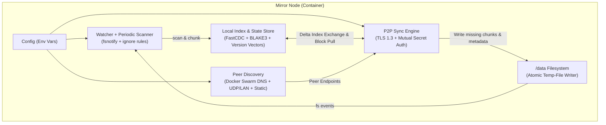

# Mirror — Distributed Folder Synchronization Design & Implementation Plan

`mirror` is a lightweight, zero-UI, distributed folder synchronization daemon written in Go, designed for Docker Swarm and LAN deployments. It keeps a target directory (`/data` by default) synchronized across multiple peers with minimal configuration and resource overhead.

---

## 1. Architecture Overview



### Core Design Decisions

1. **Chunking & Hashing (FastCDC + BLAKE3)**
   - **FastCDC (Content-Defined Chunking)** + **BLAKE3** hashing:
     - Uses a rolling gear hash to find natural chunk boundaries (min 16KB, avg 64KB, max 256KB).
     - Inserting or removing bytes in the middle of a file (e.g., configs, logs, SQLite DBs) only invalidates the affected chunk rather than shifting all subsequent blocks.
     - Small files (< 16KB) are stored and transferred as a single chunk.
     - **BLAKE3** provides fast cryptographic hashing with minimal CPU footprint.

2. **State & Empty-Node Safety (Why an empty node never wipes the cluster)**
   - **Deletions are explicit events (Tombstones)**:
     - Every node persists a lightweight state database (outside `/data`, default `/var/lib/mirror/state.db` via `bbolt`) storing known `FileInfo` entries and their **Version Vector** (`map[NodeID]uint64`).
     - A file is only marked `Deleted: true` (Tombstone) when a node **previously tracked the file in its local state** and subsequently sees it removed from disk.
     - When a brand-new empty node starts up, its state is empty (`{}`). It announces an empty index (no tombstones) and pulls all active files from peers.
     - When a new node starts with pre-populated files, it indexes them with version `{self: 1}` and their local `mtime`. Upon connecting to peers, any overlapping paths with concurrent versions are resolved via the Conflict Resolver (LWW by `mtime` + deterministic tie-breaker).

3. **Conflict Detection & Resolution**
   - Each file entry carries:
     - `Version`: Version Vector `map[NodeID]uint64`
     - `ModTimeNs`: `int64` (nanoseconds since epoch)
     - `ModifiedBy`: `NodeID`
   - When comparing Remote (`R`) vs Local (`L`):
     - If `R` dominates `L` (`R > L`): Accept `R` (fast-forward).
     - If `L` dominates `R` (`L > R`): Keep `L` (peer will pull from us).
     - If `R` and `L` are **concurrent** (`R || L`):
       - If both are deleted, or content hash (`FileHash`), type, symlink target, and permissions match: merge version vectors (`max(L, R)`) silently without conflict.
       - Otherwise, a **true conflict** occurred:
         - Log a `WARN` with the file path, winning node, losing node, and timestamps.
         - Winner is chosen by higher `ModTimeNs` (tie-broken deterministically by `FileHash`, then `ModifiedBy` lexicographically so all nodes converge on the exact same winner).
         - **`MIRROR_CONFLICT_STRATEGY=lww` (default)**: Overwrite with winner, set merged version vector `max(L, R)` with winning node incremented.
         - **`MIRROR_CONFLICT_STRATEGY=keep-copy`**: If the local node's existing file is the loser (and isn't deleted), copy/rename the losing local file to `<name>.sync-conflict-<YYYYMMDD-HHMMSS>-<shortNodeID><ext>` before writing the winner.

4. **Metadata & Special File Handling**
   - **Regular files**: Sync content via FastCDC blocks, preserve `Mode` (permissions), `ModTime` (nanosecond precision via `os.Chtimes` / `unix.UtimesNanoAt`), and `Uid`/`Gid` (via `os.Lchown`; if running unprivileged and `chown` fails with `EPERM`/`EACCES`, log a warning/debug and continue without failing the sync).
   - **Directories**: Sync creation, deletions, permissions (`Mode`), `Uid`/`Gid`, and `ModTime`.
   - **Symlinks**: Read target via `os.Readlink`, sync symlink target string, recreate atomically with symlink + `unix.UtimesNanoAt(..., AT_SYMLINK_NOFOLLOW)` + `os.Lchown`.
   - **Device files, FIFOs, Sockets**: Detect via `os.ModeDevice | os.ModeNamedPipe | os.ModeSocket | os.ModeCharDevice`, log a `WARN` (`"ignoring unsupported special file"`), and skip.

5. **Atomic File Updates & Loop Prevention**
   - Incoming files are assembled in a hidden staging file in the target directory (`.mirror.tmp.<name>.<rand>`), reusing matching chunks from the local file on disk (or other local files via block index) and pulling only missing chunks from peers.
   - Before renaming into place, permissions, ownership, and `mtime` are applied, then `os.Rename` atomically swaps the file into place.
   - All `.mirror.tmp.*` internal files are always ignored by the scanner and watcher, and the local store is updated so `fsnotify` recognizes the file state matches the store and does not re-increment the version vector.

6. **Peer Discovery (Docker Swarm + LAN + Static)**
   - **Docker Swarm DNS Discovery (`MIRROR_DISCOVERY_DNS`)**:
     - In Docker Swarm, setting `MIRROR_DISCOVERY_DNS=tasks.<service_name>` (or comma-separated DNS names) queries DNS `A`/`AAAA` records periodically, automatically discovering all container IPs in the Swarm service and connecting to each peer (filtering out self via NodeID handshake and local IPs).
   - **LAN Broadcast / Multicast UDP Discovery (`MIRROR_DISCOVERY_LAN=true`, default on)**:
     - Periodically broadcasts a discovery beacon on UDP port `22002` (authenticated with HMAC of `MIRROR_SECRET` so nodes with different secrets are ignored at discovery time as well).
   - **Static Peers (`MIRROR_PEERS`)**:
     - Comma-separated list of `host:port` endpoints.

7. **Security & Secret Handshake**
   - Ephemeral self-signed TLS 1.3 certificates generated in-memory at startup for transport encryption.
   - Immediately upon connection, both sides perform a mutual challenge-response HMAC handshake using `HMAC-SHA256(MIRROR_SECRET, role || localNonce || remoteNonce || localNodeID || remoteNodeID)`.
   - Because the HMAC derives from `MIRROR_SECRET` (even when `MIRROR_SECRET=""`), two nodes will **only** sync if their `MIRROR_SECRET` values are byte-for-byte identical. Mismatched peers are rejected and logged at `WARN` level.

8. **Exclusions**
   - Configured via `MIRROR_EXCLUDE` (comma-separated glob patterns, e.g., `*.tmp,.git,node_modules,*.log`).
   - Internal staging files (`.mirror.tmp.*`) are always excluded.
   - Supports file name globs (`*.swp`), path globs (`cache/**`, `a/b/*.txt`), and directory-level exclusions (skips descending into excluded directories in both scanner and watcher).

---

## 2. Configuration (Environment Variables)

| Variable | Default | Description |
| :--- | :--- | :--- |
| `MIRROR_PATH` | `/data` | Folder path to synchronize |
| `MIRROR_STATE_DIR` | `/var/lib/mirror` | Directory for local metadata state DB & persisted node ID |
| `MIRROR_NODE_ID` | *(auto-generated/persisted)* | Unique node identifier (defaults to persisted random ID in `MIRROR_STATE_DIR`) |
| `MIRROR_LISTEN_ADDR` | `:22001` | TCP address for P2P sync protocol |
| `MIRROR_SECRET` | `""` | Shared secret; both peers must have the exact same value (including empty) |
| `MIRROR_PEERS` | `""` | Comma-separated static peer addresses (`host:22001`) |
| `MIRROR_DISCOVERY_DNS` | `""` | Comma-separated DNS names to poll (e.g., `tasks.mirror` in Docker Swarm) |
| `MIRROR_DISCOVERY_LAN` | `true` | Enable UDP broadcast LAN peer discovery |
| `MIRROR_DISCOVERY_PORT` | `22002` | UDP port for LAN discovery |
| `MIRROR_EXCLUDE` | `""` | Comma-separated exclusion patterns (files & folders) |
| `MIRROR_CONFLICT_STRATEGY` | `lww` | `lww` (Last-Write-Wins + warn) or `keep-copy` (save `.sync-conflict-*` + warn) |
| `MIRROR_RESCAN_INTERVAL` | `60s` | Full filesystem safety scan interval |
| `MIRROR_DEBOUNCE_DELAY` | `500ms` | Debounce window for rapid file writes |
| `MIRROR_LOG_LEVEL` | `info` | `debug`, `info`, `warn`, `error` |

---

## 3. Repository Structure & Implementation Plan

```text
mirror/
├── DESIGN.md                    # Architectural design and implementation progress
├── cmd/
│   └── mirror/
│       └── main.go              # Entrypoint, signal handling, component wiring
├── internal/
│   ├── config/
│   │   ├── config.go            # Env variable parsing & validation
│   │   └── config_test.go
│   ├── ignore/
│   │   ├── matcher.go           # File & folder exclusion matcher (globs + path rules)
│   │   └── matcher_test.go
│   ├── chunker/
│   │   ├── fastcdc.go           # Content-Defined Chunking (FastCDC) + BLAKE3 hashing
│   │   └── fastcdc_test.go
│   ├── model/
│   │   ├── vclock.go            # Version Vector compare, merge, conflict resolution
│   │   ├── fileinfo.go          # FileInfo, BlockInfo, FileType (File, Dir, Symlink)
│   │   └── vclock_test.go
│   ├── store/
│   │   ├── store.go             # Persistent state store (bbolt) + local block cache map
│   │   └── store_test.go
│   ├── fs/
│   │   ├── metadata.go          # OS-level stat/lstat/chmod/chown/lutimes helpers
│   │   ├── scanner.go           # Full scanner, metadata reader, device warning
│   │   ├── watcher.go           # Recursive fsnotify watcher with 500ms debounce
│   │   ├── writer.go            # Atomic file reconstruction (local block reuse + remote blocks + metadata)
│   │   └── fs_test.go
│   ├── protocol/
│   │   ├── messages.go          # Wire message types (Hello/Auth, IndexDump, IndexUpdate, BlockReq/Resp)
│   │   ├── codec.go             # Length-prefixed binary framing over TLS 1.3
│   │   ├── auth.go              # Mutual secret HMAC handshake & self-signed TLS generator
│   │   └── protocol_test.go
│   ├── discovery/
│   │   ├── manager.go           # Combines Static, Swarm DNS (`tasks.<service>`), and UDP LAN discovery
│   │   ├── dns.go               # Periodic DNS resolver for Docker Swarm headless/tasks services
│   │   ├── lan.go               # UDP broadcast beacon & listener (port 22002, HMAC-authenticated)
│   │   └── discovery_test.go
│   └── sync/
│       ├── engine.go            # Peer session manager, delta exchange, conflict resolution, block puller
│       └── engine_test.go       # Multi-node integration tests (empty join, LWW conflict, exclusions, etc.)
├── Dockerfile                   # Multi-stage build -> minimal image syncing /data by default
├── docker-compose.swarm.yml     # Example Docker Swarm stack deployment
└── README.md                    # Usage, architecture, and Swarm setup guide
```

### Step-by-Step Implementation Plan

- [x] **Step 1: Project Initialization & Core Domain (`model`, `config`, `ignore`)**
  - Initialize Go module (`go.mod` — `module github.com/mirror-sync/mirror`, Go 1.26.2).
  - Implement `VersionVector` (`Compare`: `CmpEqual`, `CmpDominates`, `CmpDominated`, `CmpConcurrent`, `Merge`, `Increment`, `Clone`, and symmetric deterministic LWW `ResolveConflict`) and `FileInfo` / `BlockInfo` models in `internal/model`.
  - Implement `config` from environment variables with validation, defaults (`:22001`, `22002`, `500ms`, `60s`, `/data`, `lww`), and atomic `LoadOrCreateNodeID` persistence in `internal/config`.
  - Implement `ignore.Matcher` for file and folder exclusions (supporting single-segment, path-anchored, directory-only, and `**` globs, plus built-in `.mirror.tmp.*` and `.mirror.db*` exclusions) in `internal/ignore`.
  - Unit tests & documentation update.

- [x] **Step 2: FastCDC Chunker & Persistent State Store (`chunker`, `store`)**
  - Implement FastCDC content-defined chunking (`DefaultMinSize = 16KB`, `DefaultAvgSize = 64KB`, `DefaultMaxSize = 256KB`, configurable via `chunker.Options`) using a SplitMix64-seeded 256-entry 64-bit Gear lookup table, normalized upper-bit masks (`maskS` before `AvgSize`, `maskL` after `AvgSize`), and sub-minimum chunk skipping in `internal/chunker`.
  - Implement spec-compliant 256-bit BLAKE3 cryptographic hashing (`HashBytes`, streaming Merkle-tree `blake3Hasher`) for both individual chunks and full-file digests (`ChunkReader`, `ChunkFile`).
  - Implement crash-safe persistent `store.Store` in `internal/store` backed by atomic `gob` snapshots (`state.db`) + CRC32-framed Write-Ahead Log (`state.wal`) with automatic WAL replay/recovery and compaction, maintaining a thread-safe in-memory file map (`path -> FileInfo`) and block location index (`blockHash -> []BlockLocation`) for active regular files.
  - Unit tests (`fastcdc_test.go`, `store_test.go`) & documentation update.

- [x] **Step 3: Filesystem Layer (`scanner`, `watcher`, `writer`)**
  - Implement OS metadata extraction (`ExtractMetadata`, `LstatMetadata` via `os.Lstat` for `uid`, `gid`, `mode` including setuid/setgid/sticky bits, nanosecond `mtime`, and symlink classification) and `ApplyMetadata` (`os.Lchown` with graceful `EPERM`/`EACCES` handling, `os.Chmod`, `os.Chtimes`, and Linux `utimensat` with `AT_SYMLINK_NOFOLLOW` for symlinks) in `internal/fs/metadata.go`.
  - Implement `Scanner` (`ScanAll`, `ScanPath`, `ScanPaths`) with `ignore.Matcher` filtering, `WARN` logging on unsupported special files (devices/FIFOs/sockets), fast-path metadata comparison for unchanged regular files, and tombstone generation only for previously tracked entries in `internal/fs/scanner.go`.
  - Implement zero-dependency recursive Linux `inotify` `Watcher` (`syscall.InotifyInit1` + `syscall.InotifyAddWatch`) with dynamic subdirectory watch registration, ignore filtering, and configurable `500ms` debouncing in `internal/fs/watcher.go`.
  - Implement atomic `Writer` (`ApplyRemoteFile`, `SaveConflictCopy`) that reconstructs files in `.mirror.tmp.<name>.<rand>` staging files by reusing verified local blocks via `store.LookupBlock` before fetching missing remote blocks, verifies full-file BLAKE3 hashes, applies metadata and store state prior to atomic `os.Rename`, and saves `<base>.sync-conflict-<YYYYMMDD-HHMMSS>-<shortNodeID><ext>` backups in `internal/fs/writer.go`.
  - Unit tests (`fs_test.go`) & documentation update.

- [x] **Step 4: Wire Protocol, Secret Auth & Peer Discovery (`protocol`, `discovery`)**
  - Implement in-memory ephemeral ECDSA P-256 self-signed TLS 1.3 certificate generator (`GenerateTLSConfig` enforcing `MinVersion: tls.VersionTLS13`) and mutual challenge-response HMAC-SHA256 handshake (`Handshake`, `ComputeAuthHMAC`) bound to the TLS 1.3 session via `ExportKeyingMaterial("EXPORTER-mirror-v1", nil, 32)`, verifying identical `MIRROR_SECRET` values (both non-empty and empty `""`) and rejecting self-connections (`ErrSelfConnection`) and mismatched secrets (`ErrSecretMismatch`) in `internal/protocol/auth.go`.
  - Implement thread-safe framed duplex `Conn` (`[1B MsgType][4B uint32 length][payload]`, 16 MiB `DefaultMaxFrameSize`) supporting `MsgAuthChallenge` (`HelloChallenge`), `MsgAuthResponse` (`AuthProof`), `MsgAuthResult` (`AuthAck`), `MsgIndexExchange`, `MsgIndexUpdate`, `MsgBlockRequest`, `MsgBlockResponse`, `MsgPing`, and `MsgPong` in `internal/protocol/messages.go` and `internal/protocol/codec.go`.
  - Implement `discovery.Manager` coordinating periodic static peer announcements (`SourceStatic`), injectable Docker Swarm multi-IP DNS polling (`DNSDiscoverer`, `SourceDNS`), and `SO_REUSEADDR`/`SO_REUSEPORT` UDP LAN broadcast discovery (`LANDiscoverer`, `EncodeBeacon`, `VerifyBeacon`, `SourceLAN`) authenticated with `HMAC-SHA256(MIRROR_SECRET, ...)` on port `22002` in `internal/discovery`.
  - Unit tests (`protocol_test.go`, `discovery_test.go`) & documentation update.

- [x] **Step 5: Distributed Sync Engine & CLI Entrypoint (`sync`, `cmd/mirror`)**
  - Implement `sync.Engine` and `sync.PeerSession` in `internal/sync/engine.go` coordinating initial `ScanAll`, `Watcher` real-time updates, periodic safety rescans (`RescanInterval`), TLS 1.3 listener, `discovery.Manager`, and deterministic duplicate connection tie-breaking (`isOutbound == (localNodeID < remoteNodeID)`).
  - Implement full-duplex `MsgIndexExchange` and `MsgIndexUpdate` reconciliation ordering directory creations parent-first, regular files/symlinks next, and deletions child-first, with per-path serialization, VersionVector comparison, deterministic LWW conflict resolution (`ResolveConflict`), conflict warning logs, `.sync-conflict-*` backup preservation (`keep-copy`), and verified BLAKE3 block serving/fetching with multi-peer fallback.
  - Implement `cmd/mirror/main.go` wiring `config.FromEnv()`, `slog` level configuration, `config.LoadOrCreateNodeID`, `store.Open`, `sync.NewEngine`, and graceful `SIGINT`/`SIGTERM` shutdown.
  - Multi-node integration tests (`engine_test.go`) & documentation update.

- [x] **Step 6: End-to-End Verification, Dockerfile & Documentation**
  - Comprehensive multi-node integration tests verifying:
    - 3-node mesh sync (create, edit, partial block update, delete, symlink, permissions).
    - Empty new node joining an existing cluster without deleting cluster data.
    - Pre-populated new node joining and resolving via LWW (and `keep-copy`).
    - Mismatched `MIRROR_SECRET` rejection.
    - Device/FIFO file warning & exclusion rules.
    - LAN UDP & Docker Swarm DNS discovery integration with the sync engine.
  - Create `Dockerfile` (defaulting to `/data`, port `22001`/`22002`), `.dockerignore`, and `docker-compose.swarm.yml`.
  - Write `README.md` and finalize `DESIGN.md`.
