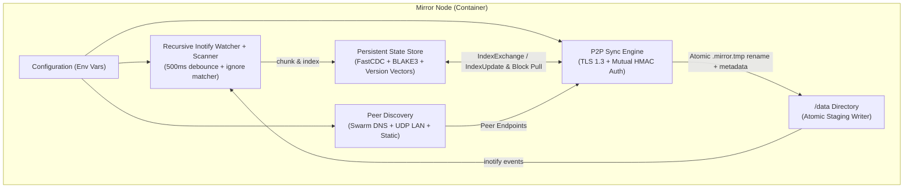

# Mirror

`mirror` is a lightweight, zero-UI, zero-external-dependency distributed folder synchronization daemon written in Go. Designed for Docker Swarm clusters, multi-node servers, and LAN environments, it keeps a target directory (`/data` by default) continuously synchronized across peers with minimal CPU and memory overhead.

---

## Table of Contents

- [Overview & Goals](#overview--goals)
- [How It Works](#how-it-works)
- [Configuration (Environment Variables)](#configuration-environment-variables)
- [Makefile Commands](#makefile-commands)
- [Example Setups](#example-setups)
    - [1. Docker Swarm Deployment (Auto-Discovery across Nodes)](#1-docker-swarm-deployment-auto-discovery-across-nodes)
    - [2. Multi-Host LAN Deployment with Docker](#2-multi-host-lan-deployment-with-docker)
    - [3. Local Two-Node Setup (Standalone Binary)](#3-local-two-node-setup-standalone-binary)
- [Conflict Resolution, Node Bootstrap & Exclusions](#conflict-resolution-node-bootstrap--exclusions)
- [Project Layout](#project-layout)

---

## Overview & Goals

Traditional synchronization tools often require web UIs, manual device pairing, heavy sidecar databases, or fixed-size block hashing. `mirror` focuses purely on headless, automated cluster folder synchronization:

- **Distributed Peer-to-Peer Mesh**: Every node is an equal peer—no master/leader node required.
- **FastCDC + BLAKE3 Delta Sync**: Content-Defined Chunking (16 KB min, 64 KB avg, 256 KB max) paired with 256-bit BLAKE3 hashing ensures that inserting or modifying bytes in the middle of a file (such as SQLite databases, configs, or logs) only transfers the changed chunk(s) over the network while reusing unchanged blocks locally.
- **Real-Time Propagation**: Native Linux `inotify` recursive directory watching with configurable write debouncing (`500ms` default) plus periodic full safety rescans (`60s` default).
- **Empty-Node Safe**: Deletions are tracked as explicit tombstones (`Deleted: true`) in a persistent state store (`/var/lib/mirror`) separate from `/data`. A newly spun-up empty node pulls existing files from peers without ever wiping the cluster.
- **Automatic Conflict Resolution**: Version Vectors track causal history per file. Concurrent edits are logged at `WARN` level and resolved deterministically via Last-Write-Wins (`lww` by `mtime`, with optional `keep-copy` conflict backups).
- **Full Metadata & Symlink Preservation**: Preserves permissions (`chmod` + setuid/setgid/sticky bits), ownership (`uid`/`gid` via `lchown`), nanosecond modification times (`utimensat`), and symbolic links (`Symlink`). Device files, FIFOs, and sockets log a warning and are safely skipped.
- **Zero-Config Discovery & Mutual Secret Auth**: Discovers peers via Docker Swarm DNS (`tasks.<service>`), UDP LAN broadcast beacons (port `22002`), or static addresses (`MIRROR_PEERS`), and authenticates peers over TLS 1.3 using a mutual `HMAC-SHA256` handshake of `MIRROR_SECRET`.

---

## How It Works



1. **Startup & Indexing**: On startup, `mirror` loads its persistent `node_id` and state database from `MIRROR_STATE_DIR` (`/var/lib/mirror`) and scans `MIRROR_PATH` (`/data`). Unchanged files skip re-chunking via a fast metadata check (`size`, `mtime`, `mode`, `uid`, `gid`).
2. **Discovery & TLS 1.3 Handshake**: Nodes discover peers via Swarm DNS (`tasks.<service>`), LAN UDP broadcasts (`22002/udp`), or static peer lists (`MIRROR_PEERS`). Over TLS 1.3 (`22001/tcp`), both sides verify they possess the exact same `MIRROR_SECRET` (even when empty `""`) using a session-bound challenge-response HMAC.
3. **Delta Index Exchange**: Connected peers exchange their file indexes (`MsgIndexExchange`) and stream live updates (`MsgIndexUpdate`) as files change.
4. **Block-Level Reconstruction**: When a peer has a newer file version, the receiving node creates a hidden staging file (`.mirror.tmp.<name>.<rand>`), reuses any matching chunks already present on local disk, requests only the missing chunks (`MsgBlockRequest`), verifies each chunk's BLAKE3 digest and the full file digest, applies metadata (`uid`/`gid`, `mode`, `mtime`), and atomically renames the file into place.

---

## Configuration (Environment Variables)

All configuration is controlled via environment variables:

| Variable                   | Default            | Description                                                                                            |
| :------------------------- | :----------------- | :----------------------------------------------------------------------------------------------------- |
| `MIRROR_PATH`              | `/data`            | Directory path to synchronize across peers                                                             |
| `MIRROR_STATE_DIR`         | `/var/lib/mirror`  | Directory for local metadata state DB (`state.db`, `state.wal`) and `node_id`                          |
| `MIRROR_NODE_ID`           | _(auto-generated)_ | Unique node identifier (auto-generated and persisted in `MIRROR_STATE_DIR/node_id` if unset)           |
| `MIRROR_LISTEN_ADDR`       | `:22001`           | TCP listen address for the TLS 1.3 P2P sync protocol                                                   |
| `MIRROR_SECRET`            | `""`               | Shared secret; two nodes only sync if their `MIRROR_SECRET` values match (including empty `""`)        |
| `MIRROR_PEERS`             | `""`               | Comma-separated static peer addresses (e.g. `10.0.1.10:22001,10.0.1.11:22001`)                         |
| `MIRROR_DISCOVERY_DNS`     | `""`               | Comma-separated DNS names to poll for peer IPs (e.g. `tasks.mirror` in Docker Swarm)                   |
| `MIRROR_DISCOVERY_LAN`     | `true`             | Enable UDP broadcast LAN peer discovery                                                                |
| `MIRROR_DISCOVERY_PORT`    | `22002`            | UDP port used for LAN broadcast discovery beacons                                                      |
| `MIRROR_EXCLUDE`           | `""`               | Comma-separated glob patterns for excluded files and folders (e.g. `*.tmp,.git,node_modules,cache/**`) |
| `MIRROR_CONFLICT_STRATEGY` | `lww`              | Conflict strategy: `lww` (Last-Write-Wins + warn) or `keep-copy` (save `.sync-conflict-*` + warn)      |
| `MIRROR_DEBOUNCE_DELAY`    | `500ms`            | Debounce window coalescing rapid filesystem writes before chunking and syncing                         |
| `MIRROR_RESCAN_INTERVAL`   | `60s`              | Periodic full filesystem safety scan interval                                                          |
| `MIRROR_LOG_LEVEL`         | `info`             | Log level (`debug`, `info`, `warn`, `error`)                                                           |

---

## Makefile Commands

A [`Makefile`](Makefile) is provided for common development, testing, benchmarking, and container workflows:

```bash
make help          # Show all available Makefile targets
make build         # Build static binary into ./bin/mirror
make test          # Run all unit and integration tests
make test-race     # Run all tests with the Go race detector enabled
make test-short    # Run fast unit tests only
make bench         # Run FastCDC, BLAKE3, ignore matcher, and store benchmarks
make cover         # Run tests and generate HTML coverage report (coverage.html)
make check         # Run go fmt and go vet
make run           # Build and run mirror locally using ./tmp/data and ./tmp/state
make docker        # Build Docker image (mirror:latest)
make docker-run    # Run mirror Docker container mounting ./tmp/data to /data
make swarm-deploy  # Deploy mirror stack to Docker Swarm (docker-compose.swarm.yml)
make swarm-rm      # Remove mirror stack from Docker Swarm
make clean         # Remove build artifacts, coverage files, and ./tmp
```

---

## Example Setups

### 1. Docker Swarm Deployment (Auto-Discovery across Nodes)

In Docker Swarm, deploying `mirror` with `mode: global` runs one container on every Swarm node. By setting `MIRROR_DISCOVERY_DNS=tasks.mirror` (where `mirror` is the service name), Docker's embedded Swarm DNS returns the overlay IP addresses of all running task replicas, allowing every node to find and mesh with all other nodes automatically.

**`docker-compose.swarm.yml`:**

```yaml
version: "3.8"

services:
    mirror:
        image: mirror:latest
        environment:
            MIRROR_PATH: /data
            MIRROR_STATE_DIR: /var/lib/mirror
            MIRROR_LISTEN_ADDR: ":22001"
            MIRROR_DISCOVERY_DNS: "tasks.mirror"
            MIRROR_DISCOVERY_LAN: "false"
            MIRROR_DISCOVERY_PORT: "22002"
            MIRROR_SECRET: "${MIRROR_SECRET:-change-me-cluster-secret}"
            MIRROR_EXCLUDE: "*.tmp,*.swp,.git,node_modules"
            MIRROR_CONFLICT_STRATEGY: "lww"
            MIRROR_DEBOUNCE_DELAY: "500ms"
            MIRROR_RESCAN_INTERVAL: "60s"
            MIRROR_LOG_LEVEL: "info"
        volumes:
            - /srv/mirror/data:/data
            - /srv/mirror/state:/var/lib/mirror
        networks:
            - mirror-net
        deploy:
            mode: global
            endpoint_mode: dnsrr
            restart_policy:
                condition: any
                delay: 5s

networks:
    mirror-net:
        driver: overlay
        attachable: true
```

**Deploy the stack:**

```bash
# Create host directories on each Swarm node first:
# sudo mkdir -p /srv/mirror/data /srv/mirror/state

# Build image and deploy stack:
make docker
MIRROR_SECRET="my-cluster-secret" make swarm-deploy
```

Whenever a new node joins the Docker Swarm cluster, Swarm schedules a `mirror` task on that node, `tasks.mirror` DNS updates automatically, and the new node pulls `/srv/mirror/data` from existing nodes.

---

### 2. Multi-Host LAN Deployment with Docker

On a local network (without Swarm), nodes can discover each other automatically via UDP broadcast beacons on port `22002/udp`:

```bash
# Build image
make docker

# On Host 1 (192.168.1.10)
docker run -d --name mirror --restart unless-stopped \
  --network host \
  -e MIRROR_SECRET="lan-shared-secret" \
  -e MIRROR_EXCLUDE="*.tmp,.git,node_modules" \
  -v /srv/shared:/data \
  -v /var/lib/mirror:/var/lib/mirror \
  mirror:latest

# On Host 2 (192.168.1.11)
docker run -d --name mirror --restart unless-stopped \
  --network host \
  -e MIRROR_SECRET="lan-shared-secret" \
  -e MIRROR_EXCLUDE="*.tmp,.git,node_modules" \
  -v /srv/shared:/data \
  -v /var/lib/mirror:/var/lib/mirror \
  mirror:latest
```

_(If UDP broadcasts are blocked between subnets, specify `-e MIRROR_PEERS="192.168.1.10:22001"` instead.)_

---

### 3. Local Two-Node Setup (Standalone Binary)

You can test a two-node cluster locally on a single machine using different ports and directories:

```bash
# Build binary into ./bin/mirror
make build

# Terminal 1 — Start Node A listening on :22001
mkdir -p /tmp/mirror-a/data /tmp/mirror-a/state
MIRROR_PATH=/tmp/mirror-a/data \
MIRROR_STATE_DIR=/tmp/mirror-a/state \
MIRROR_LISTEN_ADDR=:22001 \
MIRROR_DISCOVERY_PORT=22002 \
MIRROR_SECRET="demo-secret" \
./bin/mirror

# Terminal 2 — Start Node B listening on :22011 (auto-discovers Node A via UDP port 22002)
mkdir -p /tmp/mirror-b/data /tmp/mirror-b/state
MIRROR_PATH=/tmp/mirror-b/data \
MIRROR_STATE_DIR=/tmp/mirror-b/state \
MIRROR_LISTEN_ADDR=:22011 \
MIRROR_DISCOVERY_PORT=22002 \
MIRROR_SECRET="demo-secret" \
./bin/mirror
```

Now any file created, edited, chmodded, symlinked, or deleted in `/tmp/mirror-a/data` will sync to `/tmp/mirror-b/data` within ~500ms, and vice versa.

---

## Conflict Resolution, Node Bootstrap & Exclusions

### Empty Node Joining an Existing Cluster

When a new node starts with an empty `/data` directory and a fresh `/var/lib/mirror` state store:

1. Its initial scan finds 0 files and emits **0 tombstones** (tombstones are only created when a previously tracked file is removed from disk).
2. Upon connecting to cluster peers, the new node receives their `IndexExchange` entries, sees that remote Version Vectors dominate its empty state, and pulls all files, directories, symlinks, and metadata.

### Pre-Populated Node Joining an Existing Cluster

When a new node already has files in `/data` before joining:

1. Its initial scan indexes those files with version `{newNodeID: 1}` and their on-disk `mtime`.
2. Non-overlapping files (files unique to the new node or unique to existing nodes) merge cleanly onto all nodes.
3. Overlapping files with different content have concurrent Version Vectors (`{nodeA: 1}` vs `{nodeB: 1}`):
    - `mirror` logs a `WARN` entry (`conflict detected, resolved via LWW`) with the file path, winning node, losing node, and timestamps.
    - The file with the newer `mtime` wins across all nodes (ties are broken deterministically by `FileHash` and `ModifiedBy`).
    - If `MIRROR_CONFLICT_STRATEGY=keep-copy` is enabled, the node holding the losing local file saves a backup named `<name>.sync-conflict-<YYYYMMDD-HHMMSS>-<shortNodeID><ext>` before applying the winning file.

### File & Folder Exclusions (`MIRROR_EXCLUDE`)

- Supports filename globs (`*.log`, `*.swp`), directory names (`.git`, `node_modules`), trailing-slash directory-only rules (`build/`), root-anchored paths (`/tmp-dir`), and `**` recursive globs (`cache/**`).
- Excluded directories are skipped completely during both filesystem scans and `inotify` watch registration.
- Internal staging files (`.mirror.tmp.*` and `.mirror.db*`) are always excluded automatically.

---

## Project Layout

```text
mirror/
├── cmd/mirror/main.go           # Daemon entrypoint & signal handling
├── internal/
│   ├── chunker/                 # FastCDC content-defined chunking + BLAKE3 hashing
│   ├── config/                  # Environment variable configuration & NodeID persistence
│   ├── discovery/               # Static, Docker Swarm DNS (tasks.<svc>), and UDP LAN discovery
│   ├── fs/                      # Scanner, recursive inotify watcher, metadata, atomic writer
│   ├── ignore/                  # Glob & path exclusion matcher
│   ├── model/                   # Version vectors, FileInfo, BlockInfo, deterministic LWW resolver
│   ├── protocol/                # TLS 1.3 transport, mutual HMAC secret auth, wire framing
│   ├── store/                   # Crash-safe snapshot + CRC32 WAL state & block location index
│   └── sync/                    # Multi-peer sync engine, delta exchange, block puller
├── Dockerfile                   # Multi-stage Alpine container image syncing /data
├── docker-compose.swarm.yml     # Example global Docker Swarm stack
├── Makefile                     # Build, test, benchmark, and Docker automation
├── DESIGN.md                    # Detailed architecture & design documentation
└── README.md                    # User & operator documentation
```
