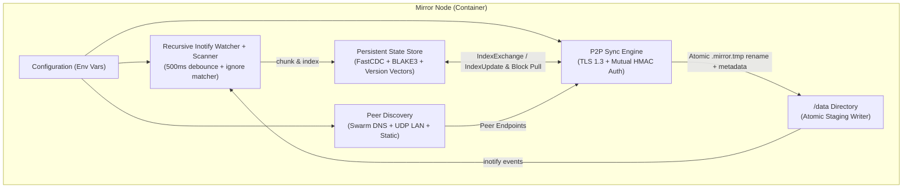

# Mirror

`mirror` is a lightweight, zero-UI, zero-external-dependency distributed folder synchronization daemon written in Go. Designed for Docker Swarm clusters, multi-node servers, and LAN environments, it keeps a target directory (`/data` by default) continuously synchronized across peers with minimal CPU and memory overhead.

---

## Key Features

- **FastCDC + BLAKE3 Delta Block Transfer**:
  - Uses Content-Defined Chunking (**FastCDC** with rolling Gear hash: 16 KB min, 64 KB avg, 256 KB max) paired with **BLAKE3** 256-bit cryptographic digests.
  - Modifying bytes in the middle of a large file only re-transfers the affected chunk(s). Existing blocks from the local file or other files in `/data` are reused locally before requesting missing blocks over the network.
- **Tombstone-Safe Empty Node Bootstrap**:
  - Deletions are tracked as explicit **tombstones** (`Deleted: true`) in a persistent state store (`/var/lib/mirror/state.db` + CRC32 WAL) separate from `/data`.
  - A file is only marked deleted if the node **previously tracked** that file and saw it removed from disk.
  - Joining a brand-new node with an empty `/data` folder **never** deletes files on existing peers—it safely pulls all cluster files.
- **Version Vectors & Deterministic LWW Conflict Resolution**:
  - Causal history is tracked per file via **Version Vectors** (`map[NodeID]uint64`).
  - Concurrent modifications (or two pre-populated nodes joining for the first time with different versions of the same file) are detected automatically, logged at `WARN` level, and resolved deterministically via **Last-Write-Wins (`mtime`)** with cryptographic tie-breaking so all peers converge on the exact same state.
  - Optional `MIRROR_CONFLICT_STRATEGY=keep-copy` preserves losing local versions as `<name>.sync-conflict-<YYYYMMDD-HHMMSS>-<shortNodeID><ext>`.
- **Mutual TLS 1.3 + Shared Secret Authentication**:
  - Every node generates an in-memory ECDSA P-256 TLS 1.3 certificate at startup and performs a mutual challenge-response HMAC-SHA256 handshake bound to the TLS 1.3 session (`RFC 8446` Exporter Keying Material).
  - Peers only sync when their `MIRROR_SECRET` values are byte-for-byte identical (including when both are empty `""`).
- **Zero-Config Peer Discovery**:
  - **Docker Swarm DNS (`MIRROR_DISCOVERY_DNS=tasks.<service>`)**: Periodically resolves multi-A/AAAA records to discover all task containers in a Swarm service.
  - **LAN UDP Broadcast (`MIRROR_DISCOVERY_LAN=true`)**: Broadcasts HMAC-authenticated discovery beacons on UDP port `22002`.
  - **Static Peers (`MIRROR_PEERS`)**: Comma-separated list of `host:port` endpoints.
- **Full Metadata, Symlink & Special File Handling**:
  - Preserves file and directory permissions (`chmod`, including setuid/setgid/sticky bits), ownership (`uid`/`gid` via `lchown` with graceful fallback when running unprivileged), and nanosecond modification times (`utimensat`).
  - Synchronizes symbolic links atomically without dereferencing targets.
  - Detects unsupported special files (device nodes, named pipes/FIFOs, sockets), logs a warning (`ignoring unsupported special file`), and skips them safely.
- **Real-Time Recursive Watcher + Debouncing**:
  - Native Linux `inotify` recursive directory watcher with configurable write debouncing (`500ms` default) plus periodic safety rescans (`60s` default).

---

## Architecture



---

## Quick Start

### 1. Docker Swarm (Recommended for Multi-Host Clusters)

Deploy `mirror` as a global Swarm service so one container runs on every node and discovers all peers automatically via `tasks.mirror`:

```bash
export MIRROR_SECRET="my-production-secret"
docker stack deploy -c docker-compose.swarm.yml mirror
```

See [`docker-compose.swarm.yml`](docker-compose.swarm.yml) for the complete stack configuration.

### 2. Docker CLI (LAN or Static Peers)

Build the image:

```bash
docker build -t mirror:latest .
```

Run on **Host A** (`192.168.1.10`):

```bash
docker run -d --name mirror \
  --network host \
  -e MIRROR_SECRET="shared-secret" \
  -e MIRROR_EXCLUDE="*.tmp,.git,node_modules" \
  -v /srv/data:/data \
  -v /srv/mirror-state:/var/lib/mirror \
  mirror:latest
```

Run on **Host B** (`192.168.1.11`):

```bash
docker run -d --name mirror \
  --network host \
  -e MIRROR_SECRET="shared-secret" \
  -e MIRROR_EXCLUDE="*.tmp,.git,node_modules" \
  -v /srv/data:/data \
  -v /srv/mirror-state:/var/lib/mirror \
  mirror:latest
```

With `--network host` (or UDP port `22002` and TCP port `22001` exposed on the same L2 subnet), both nodes discover each other automatically via UDP LAN beacons. Across routed networks, set `-e MIRROR_PEERS="192.168.1.10:22001"`.

### 3. Standalone Binary

Build a static binary:

```bash
CGO_ENABLED=0 go build -trimpath -ldflags="-s -w" -o mirror ./cmd/mirror
```

Run locally:

```bash
MIRROR_PATH=/tmp/mirror-a \
MIRROR_STATE_DIR=/tmp/mirror-state-a \
MIRROR_LISTEN_ADDR=:22001 \
MIRROR_SECRET="my-secret" \
./mirror
```

---

## Configuration (Environment Variables)

| Variable | Default | Description |
| :--- | :--- | :--- |
| `MIRROR_PATH` | `/data` | Path to the directory to keep synchronized |
| `MIRROR_STATE_DIR` | `/var/lib/mirror` | Directory for persistent state DB (`state.db`, `state.wal`) and `node_id` |
| `MIRROR_NODE_ID` | *(auto-generated)* | Unique node identifier (persisted in `MIRROR_STATE_DIR/node_id` if unset) |
| `MIRROR_LISTEN_ADDR` | `:22001` | TCP listen address for the TLS 1.3 P2P sync protocol |
| `MIRROR_SECRET` | `""` | Shared cluster secret; peers must have the exact same value (including empty `""`) |
| `MIRROR_PEERS` | `""` | Comma-separated static peer addresses (`host:22001,other:22001`) |
| `MIRROR_DISCOVERY_DNS` | `""` | Comma-separated DNS names to poll for peer IPs (e.g. `tasks.mirror` in Docker Swarm) |
| `MIRROR_DISCOVERY_LAN` | `true` | Enable UDP broadcast LAN peer discovery |
| `MIRROR_DISCOVERY_PORT` | `22002` | UDP port used for LAN broadcast discovery beacons |
| `MIRROR_EXCLUDE` | `""` | Comma-separated glob patterns for excluded files and folders (e.g. `*.tmp,.git,cache/**`) |
| `MIRROR_CONFLICT_STRATEGY` | `lww` | Conflict strategy: `lww` (Last-Write-Wins + warn) or `keep-copy` (save `.sync-conflict-*` + warn) |
| `MIRROR_RESCAN_INTERVAL` | `60s` | Full filesystem safety rescan interval |
| `MIRROR_DEBOUNCE_DELAY` | `500ms` | Debounce window coalescing rapid filesystem writes before chunking and syncing |
| `MIRROR_LOG_LEVEL` | `info` | Structured log verbosity: `debug`, `info`, `warn`, `error` |

---

## How Node Joining, Conflicts & Exclusions Work

### Empty Node Joining an Existing Cluster
When a new node starts with an empty `/data` directory and a fresh `/var/lib/mirror` state store:
1. Its initial scan finds 0 files and emits **0 tombstones** (because tombstones are only created when a previously indexed file is removed).
2. Upon connecting to cluster peers, the new node receives their `IndexExchange` entries, sees that remote Version Vectors dominate its empty state, and pulls all files, directories, symlinks, and metadata.

### Pre-Populated Node Joining an Existing Cluster
When a new node already has files in `/data` before joining:
1. Its initial scan indexes those files with version `{newNodeID: 1}` and their on-disk `mtime`.
2. Non-overlapping files (files unique to the new node or unique to existing nodes) have dominating Version Vectors and merge cleanly onto all nodes.
3. Overlapping files with different content have concurrent Version Vectors (`{nodeA: 1}` vs `{nodeB: 1}`):
   - `mirror` logs a `WARN` entry (`conflict detected, resolved via LWW`) with the file path, winning node, losing node, and timestamps.
   - The file with the newer `mtime` wins across all nodes (ties are broken deterministically by `FileHash` and `ModifiedBy`).
   - If `MIRROR_CONFLICT_STRATEGY=keep-copy` is enabled, the node holding the losing local file saves a backup named `<name>.sync-conflict-<YYYYMMDD-HHMMSS>-<shortNodeID><ext>` before applying the winning file, and that backup is synchronized across the cluster.

### File & Folder Exclusions (`MIRROR_EXCLUDE`)
- Supports filename globs (`*.log`, `*.swp`), directory names (`.git`, `node_modules`), trailing-slash directory-only rules (`build/`), root-anchored paths (`/tmp-dir`), and `**` recursive globs (`cache/**`).
- Excluded directories are skipped completely during both filesystem scans and `inotify` watch registration.
- Internal staging files (`.mirror.tmp.*` and `.mirror.db*`) are always excluded automatically.
